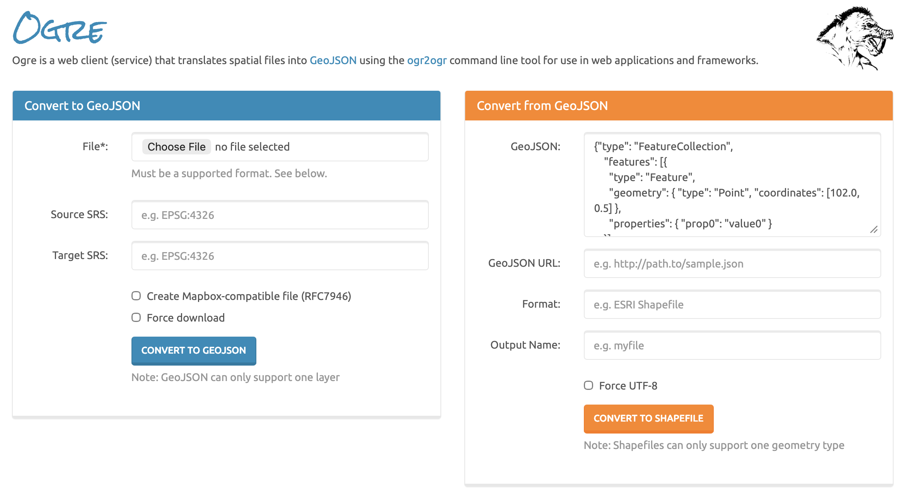

[](https://github.com/wavded/ogre/actions/workflows/build.yml) [](https://npmjs.com/package/ogre) 

Ogre is a web frontend and API for the [ogr2ogr][2] module.



## Installation

1. [Install GDAL tools][1] (includes the `ogr2ogr` command line tool)

2. Install package:

```sh
npm install -g ogre
```

## Usage

To run the app:

```sh
ogre -p 3000
```

Then visit <http://localhost:3000> in a your favorite browser.

Options include:

```
Usage: ogre [options]

Options:
 -h, --help      help
 -p, --port      port number (default 3000)
 -v, --version   version number
 -t, --timeout   timeout before ogre kills a job in ms (default 15000)
 -l, --limit     byte limit for uploads (default 50000000)
```

## Development

Install Bun and the GDAL tools, then run:

```sh
bun install
bun run lint
bun run test
bun run start
```

Run `npm pack` to build and package the CLI. Bun bundles the TypeScript into
`dist/cli.js` as an ES module for Node.js and embeds the HTML frontend. Package users need Node.js
and GDAL, not Bun.

[1]: https://gdal.org/download.html
[2]: https://github.com/wavded/ogr2ogr
[3]: https://ogre.adc4gis.com
[4]: https://github.com/wavded/ogre/wiki
